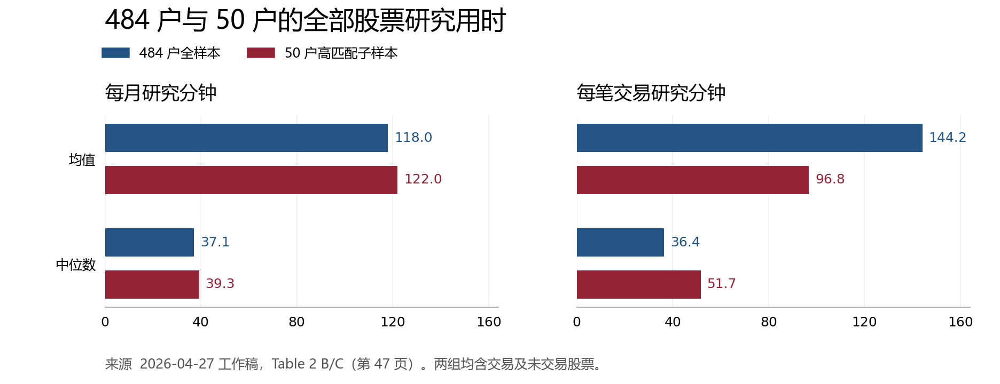

# 组会三问：PC2 得分、50 户样本与 0.0 分钟

依据本地 Laarits、Wurgler 2026 年 4 月 27 日工作稿，页码为论文 PDF 的物理页码。旧放映稿第 39 页对应终校版第 38 页。[论文原件](../On%20the%20Information%20Set%20of%20Individual%20Investors.pdf)

## 投资者的 PC2 得分怎么算，怎么分组？

**一户一个得分。** 作者先把每户已匹配股票代码的研究行为整理成一行。主题列用月均研究时间严格大于 2 分钟记 1，其他记 0。风险统计因参与太少被排除。再加入一列连续的投机标的倾向 $S_i$。这列概括该投资者偏向的股票类型，高值对应较小、较新、高波动和低名义价格的股票。Table 5 最后有 13 个主题方向的权重和 1 个连续指标的权重。来源为第 VI 节第 35 页和 Table 5 第 51 页。

按 PPT 采用的标准化 PCA 写法，把每列减去参与估计样本的均值，再除以该列标准差。设 $z_i$ 为投资者的标准化输入，$v_2$ 为第二主成分方向，得分是二者内积：

$$
\mathrm{score}_{i,2}=z_i^\top v_2=\sum_{k=1}^{14}z_{ik}v_{k,2}.
$$

Table 5 报告的方向上，快照是 +0.30，留言板是 +0.46，价格图是 +0.19，投机标的倾向是 +0.43，盈利是 −0.34，股利是 −0.47。因而快信息和投机标的输入高，通常会把得分推高。盈利、股利高，通常会把得分拉低。PC2 是这些行为的同一条统计轴，解释输入变异的 8.77%。原文第 35 页以研究标的描述 $S_i$，Table 5 表注使用交易倾向的措辞。工作稿给出了方向和载荷，没有给逐户输入、各列标准化参数或完整的 $S_i$ 构造权重，因此不能还原论文实际的逐户得分。

标准化写法与原表数值相符。以 PC1 为例，特征值 3.75 除以解释比例 26.81%，总变异约为 14，与 14 个方差为 1 的输入相符。

**算例。** 假定其他输入相同。下面四列已经标准化，+1 和 −1 表示高于与低于各列均值一个标准差。只计算这四列相对共同项的贡献。

| 假想投资者 | 快照 +0.30 | 盈利 −0.34 | 股利 −0.47 | 标的倾向 +0.43 | 四项得分 |
|---|---:|---:|---:|---:|---:|
| 甲的标准化输入 | +1 | −1 | −1 | +1 | +1.54 |
| 乙的标准化输入 | −1 | +1 | +1 | −1 | −1.54 |

甲是 `0.30×1 + (−0.34)×(−1) + (−0.47)×(−1) + 0.43×1 = 1.54`。乙四项方向相反，为 −1.54。完整得分再加上其他十列的贡献。两者的相对顺序不受共同项影响。

**分组。** 先在取得 PC2 得分的投资者中按得分排序，再取最低 20% 和最高 20%。假如只有 10 位且得分都不相同，排名第 1、2 位进低组，第 9、10 位进高组。中间 6 位不进入 Figure 5 C/D 的极端组对照。随后把各组的订单与同股研究路径汇总作图。原工作稿没有列出分位切点、并列处理或每组精确人数。来源为第 VII 节第 39 页和 Figure 5 第 56 页。

**组会上可以这样讲。** “每户的主题参与和标的倾向乘以 PC2 的权重再相加，得到一个得分。作者按得分排序，把最高和最低各五分之一拿出来比较路径。”

## 484 户和 50 户有哪些可比信息？

**选 50 户依据研究网址能否匹配股票代码。** 484 户是至少有一笔样本内美国普通股或 ADR 交易的全样本。50 户是研究链接中有很高比例能直接或通过相邻网址匹配到代码的子样本。作者把这种匹配的可行性归因于网址的结构。第 18 页说，这 50 户交易频率、总体研究投入、年龄和收入与全样本相近。工作稿没有给出数值化的匹配率门槛。

| 公开位置 | 484 户全样本 | 50 户高匹配子样本 |
|---|---|---|
| Table 1 A，第 46 页 | 户主年龄均值 50.1 岁、中位数 50 岁（467 户）。户主年收入均值 71.7 千美元、中位数 75 千美元（445 户，10 万美元封顶） | 未单列年龄、收入数值。正文定性称相近 |
| Table 1 B/C，第 46 页 | 每月券商浏览均值 214.2 分钟、中位数 81.6。每月股票交易均值 2.2 笔、中位数 0.7 笔 | 未单列这些数值。正文定性称交易频率相近 |
| Table 2 B/C，第 47 页 | 每月研究均值 118.0 分钟、中位数 37.1。全部股票每笔研究均值 144.2 分钟、中位数 36.4 | 每月研究均值 122.0 分钟、中位数 39.3。全部股票每笔研究均值 96.8 分钟、中位数 51.7 |
| Table 2 C，第 47 页 | 全样本未报告这个高匹配口径 | 限定到所交易股票，每笔研究均值 29.1 分钟、中位数 5.7 |

图和表来自[论文 Table 1，第 46 页](../On%20the%20Information%20Set%20of%20Individual%20Investors.pdf#page=46)及[Table 2，第 47 页](../On%20the%20Information%20Set%20of%20Individual%20Investors.pdf#page=47)。图中两组用相同的股票范围。每月研究的均值和中位数接近。按每笔交易算，50 户的均值较低、中位数较高。50 户包含在 484 户中，这些数字是描述性对照。论文未提供 50 户单独的人口和交易频率分布，也未报告两组的平衡检验。

**组会上可以这样讲。** “50 户主要是网址好配码，能把研究落到所交易的那只股票。论文说这组年龄、收入、交易频率都相近，表里能直接核对的是研究用时。”

## A5 补图的第 5 分位为什么是 0.0？它有效吗？

**0.0 是原表有效的报告值。** 它来自 Table 2 C 的 `Matched to Traded Ticker` 行。按第 18–19 页的口径，每户先算所交易股票的已识别研究分钟除以该户交易笔数，随后对户级比值取分位数。

$$
r_i=\frac{\text{该户样本中所交易股票的已识别研究分钟}}{\text{该户样本内股票交易笔数}}.
$$

分母有交易时，分子允许为零。例如某户有 4 笔交易，浏览期间查过其他股票，但没有观察到对所交易股票的可识别研究。该户在这一限定口径下是 `0 / 4 = 0`。线下研究、既有信息和网页匹配失败可能使实际信息获取超出点击流的计量范围。

原表只报一位小数。按常见四舍五入，低于 0.05 分钟每笔的正数也会显示成 0.0，也就是约 3 秒每笔以内。论文同页另有公司官网用时由数秒舍入到 0.0 的例子，说明这一显示方式确实可能发生，但未说明本行第 5 分位是否因舍入成为 0.0。分位数只表示分布低端的位置，不能由公布值还原精确零值的户数。没有微观数据或作者代码，无法区分这一分位是精确零还是很小的正值。来源为第 18–19 页及 [Table 2 C，第 47 页](../On%20the%20Information%20Set%20of%20Individual%20Investors.pdf#page=47)。

**组会上可以这样讲。** “原表第 5 分位报 0.0，表示样本低端几乎没有被记录到的同股研究用时。数字按一位小数公布，保留原表读数即可。”
