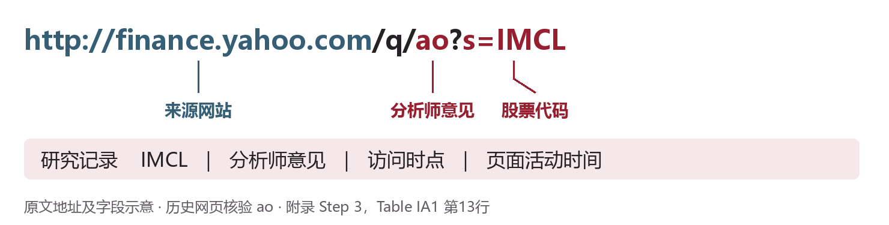
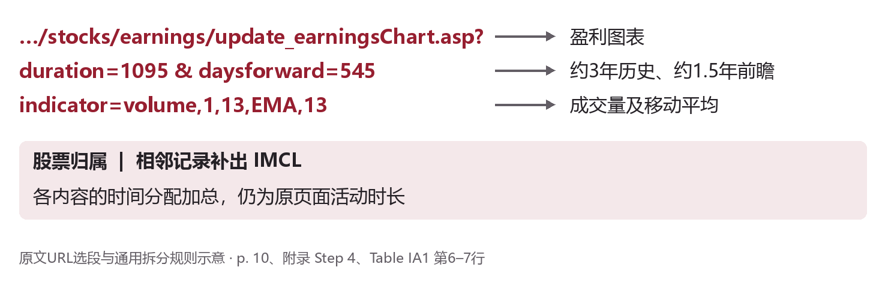
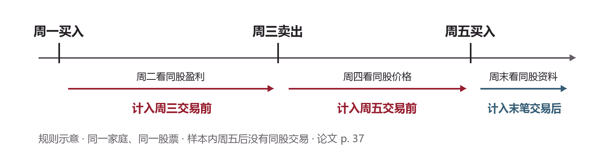
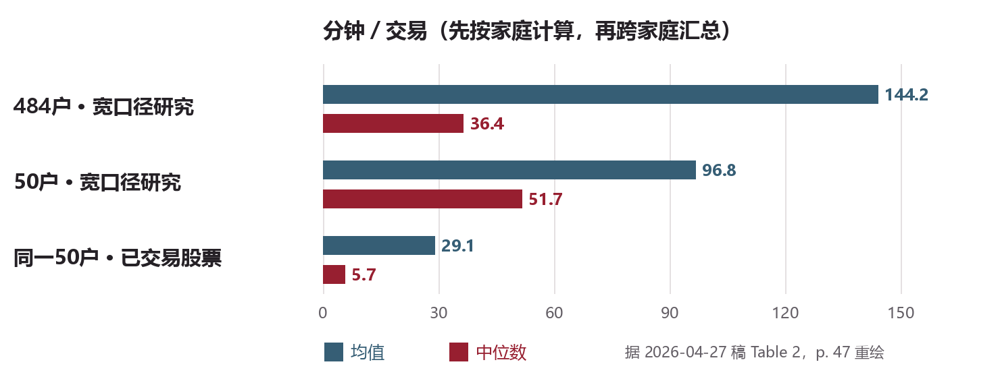
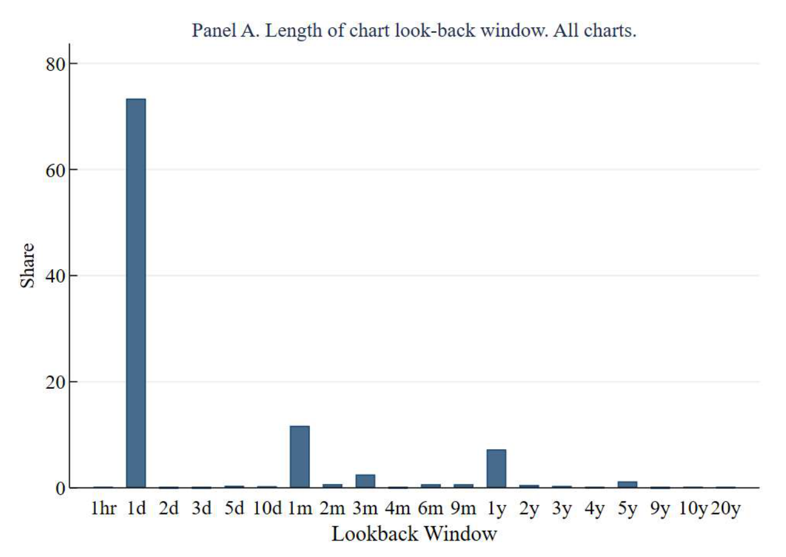
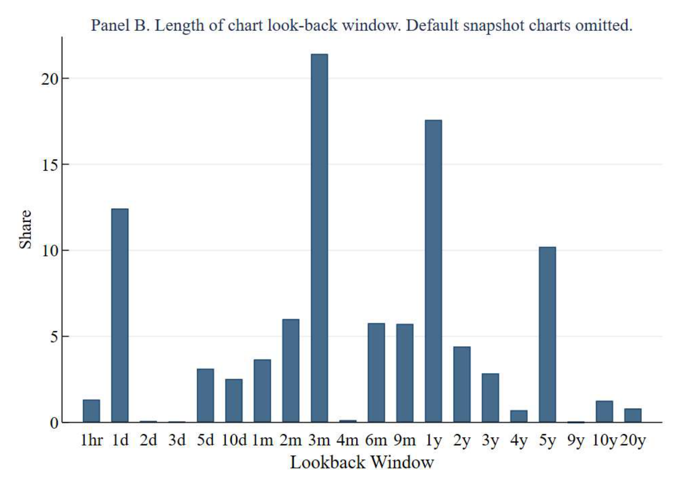
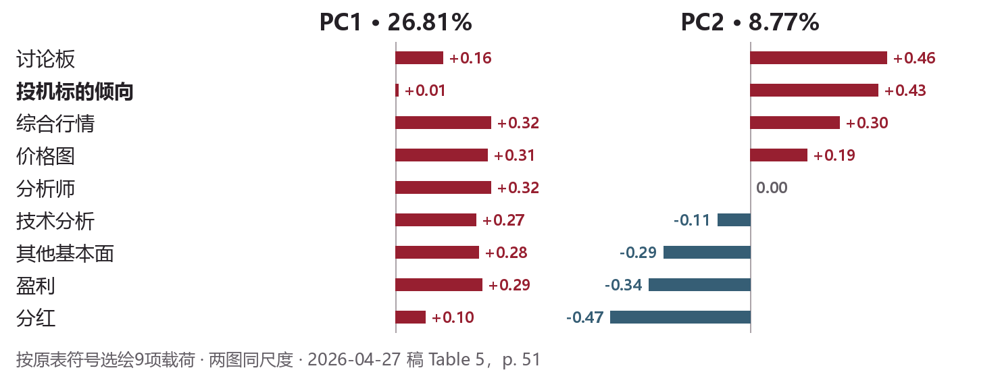
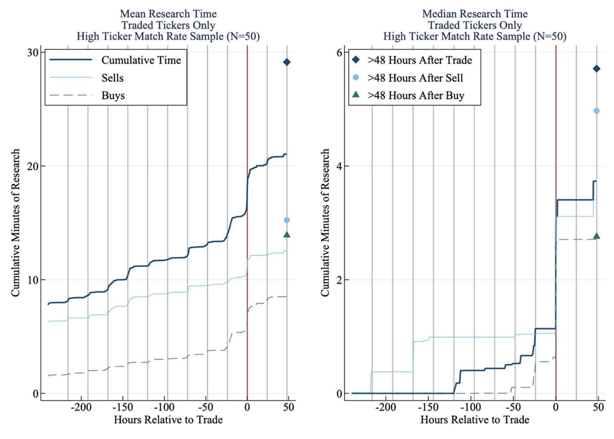
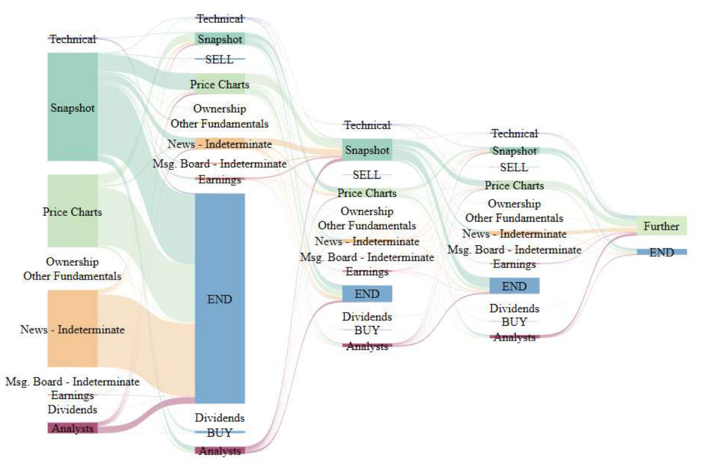
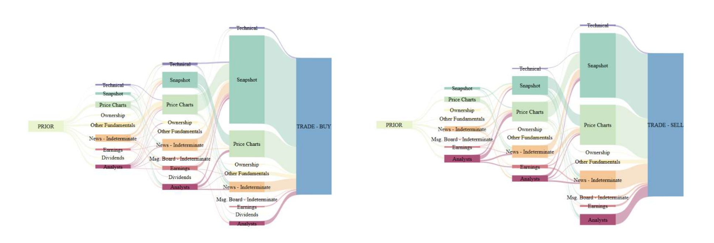

# 个人投资者的信息集

> 本文件保留为 11 月 18 日的 32 单元叙事基线。当前第二轮微调的六块 Markdown、TeX、PDF、完整口述稿和核查记录统一从[第二轮入口](../projection-20261120-round2/README.md)进入；本稿的旧页数不作为当前页码。

*On the Information Set of Individual Investors* · Toomas Laarits 与 Jeffrey Wurgler · 2026年4月27日工作稿

**研究问题**　当同一批公开资料摆在投资者面前，哪些内容实际进入了他们的股票研究？同样的“受到关注”，又为什么可能对应不同的研究投入、信息内容和交易用途？

**报告的回答**　点击流让我们看到信息获取的四个属性。典型家庭对已交易股票的可见投入有限，价格图又是最突出的单项内容。这个总体画像由不同股票和不同家庭共同形成。对齐交易后，还能看到一部分研究在下单前迅速累积。由此，均一的注意力总量既不足以描述个体获得了什么，也不足以说明这些信息怎样接近行动。

## 报告怎样从问题走到答案

同一家公司公布财报时，看到搜索量上升，我们知道它引起了关注。要判断盈利究竟有没有进入决策前的研究，还需要看投资者打开的是盈利预测、价格图，还是同时摆放多种资料的综合行情。把这一步放在买卖之前来观察，正是本篇与那些从成交或搜索指数倒推注意力的研究不同的地方。跨站URL提供内容和股票，时点把这些活动放回同一家庭的交易轨迹。

有了记录，就能问研究资源怎样配置。约六分钟和约144分钟看起来矛盾，实际对应不同家庭范围、研究范围和汇总量。将它们读清楚以后，下一步才能问有限的投入花在什么内容上。价格图是最突出的单项。含默认展示的图表以短窗口居多，主动调整的人则常选更长历史，两种分布分别回答曝光与选择的问题。

这幅总体画像还取决于哪些股票吸引了哪些人。股票层面分别比较覆盖、合计时间和内容差，发现三者可以给出不同答案。家庭层面的PCA接着问，差别只是研究得多与少，还是也存在主题与标的共同变化的方向。最后，事件图让我们回到开头的交易，观察研究何时集中、先进入何种主题、是否继续。报告收在一个可以延续的问题上：既然能够区分实际曝光与主动选择，下一步如何测量这些输入是否改变了判断？

## 汇报顺序与页面尺度

|部分|本段要回答的问题|屏幕上的主要证据|拟讲时间|
|---|---|---|---:|
|一　信息与行为资产定价 · 01–06|金融模型需要什么信息，已有数据为什么看不全？|决策链、理论输入对照、测量增量|5分钟|
|二　URL数据与测度 · 07–12|什么样的记录能把内容、家庭和交易放到一起？|两个研究URL、订单、交易归属时间线|6分钟|
|三　可比统计与总体事实 · 13–19|研究量有多大，花在何处？|家庭比率、Table 2、Table 3、Figure 1|7分钟|
|四　股票、家庭与交易 · 20–29|总体事实由谁形成，何时接近交易？|Table 4三列、PC1/PC2、Figures 3–5|12分钟|
|五　贡献与评价 · 30–32|四维事实改变了什么认识，下一步该区分什么？|研究回答、混合页口径、默认界面检验|3分钟|

32个展示单元，按33分钟分配。预算包含读图、解释和停顿，段落提供每页应说清的内容，实际时长以演练为准。沿用无水印RUC 4:3。以下字号用Beamer原尺寸作为生产起点，放映前按实际投影复核。页标题15–17 pt，正文11–12 pt，表图标签从9–10 pt起，资料出处8–9 pt，强调结果数字22–26 pt。导航只显示章节及当前子节。数据页把较大空间留给要指读的数值、坐标或链路，读图顺序写在相应单元。

每个单元中的“屏幕”给出可直接转写的内容和布局。“讲述”给出顺序及关键解释。“来源”所指均为本地2026年4月27日全文，另有说明的文献或教学示例除外。

## 一　信息与行为资产定价

### 1.1 从决策链找到论文研究的对象

**01　封面**

**屏幕**　论文英文原题居中，24 pt，中文副标题为“从浏览记录观察个体的信息获取”，16 pt。作者、NYU Stern School of Business及工作稿日期置下，11 pt。

**讲述**　我们经常从一笔成交去猜投资者为什么买卖。今天把问题往前推一步，先看哪些资料进入了投资者的研究，再问这些活动怎样接近交易。

**02　从成交回看，哪一环最难观察**

**屏幕**　图放在中部，宽92%。下方保留一句“相似的交易，可能来自不同的资料、预期和持仓”。图中酒红高亮本篇的测量对象。

**讲述**　从左到右指读。两个人同时买入某股，一个此前查了盈利，另一个只核对了价格。成交方向相同，仍不能说明两个人获取了相同的信号。形成判断还涉及理解、先验、偏好及约束。文章用网页记录补上获取环节，并利用订单时点观察获取和行动的时间关系。

**来源**　pp. 2–3、10–11。图为概念示意，箭头表示步骤，论文并未估计箭头上的因果效应。

**03　理论需要的信号各不相同**

**屏幕**　中部三行，用11 pt排成“理论中的决策任务／对应的信息”。右列用酒红突出“风险与协方差”“新闻与价格走势”“历史收益窗口”。

|理论线索|输入为什么有经济意义|
|---|---|
|组合选择|收益分布与协方差决定分散风险的权衡|
|信息扩散|新闻与价格走势在不同投资者之间逐步进入判断|
|收益外推|所看到的历史区间影响模型应使用怎样的潜在信号|

**讲述**　如果模型中的散户主要据盈利更新判断，我们就会关心盈利资料有没有实际进入其研究。如果模型强调价格外推，就还要知道他们接触的价格区间。这些是可以和行为事实对接的输入假设。市场价格反映公开信息的程度，属于价格层面的问题。市场可能已经吸收了公告，而许多家庭并没有打开它。

**来源**　pp. 2–3、6–7。理论线索按原文引言概括。

### 1.2 现有证据与新记录的区别

**04　搜索峰值告诉我们什么，还缺什么**

**屏幕**　左侧36%写“某股搜索上升”，用文字标签表示观察事实。右侧60%并列两条可能路径“打开价格图”“查盈利预测”，下方汇合到“可能有相同的搜索强度”。用简式流程，不画伪造峰值。

**讲述**　已有研究说明新闻、异常成交和极端收益能吸引散户注意。假如我们只有某股搜索量，就很难区分这些人随后是在查看价格，还是查财务资料，也无法比较这两类内容在同一投资者研究中占多大位置。最接近的券商点击流研究能连接账户行为。本文跨网站记录将站外研究也纳入，同时更细地识别内容。两种数据的可观察对象不同，后续研究信念和收益时仍需要账户侧信息。

**来源**　pp. 3、5–7、18–19。前序研究为Gargano与Rossi（2018）。

**05　本文观察了信息获取过程的哪一部分**

**屏幕**　投影文字控制为三层。顶部13 pt写“同一家庭在多个网站看了什么”。居中三列以14 pt突出“页面与内容”“股票与时点”“订单方向”。页底11 pt放一条测量限定“页面访问记录刻画在线获取行为，信念形成还需要额外数据”。

**讲述**　三个对象放在一起，才有可能从“这只股票受到关注”继续追问：哪些人查了什么、用了多久，以及这些研究发生在交易前的哪个阶段。后面的结果都从这些记录产生。比如“约六分钟”的意义，需要先知道我们怎样把同一户、同一股的活动和交易连起来。

**来源**　pp. 3–5、10–11。

**06　报告如何回答这个问题**

**屏幕**　五行两级目录。一级用13 pt，二级用10–11 pt。标题和序号写入后续页导航，不另设重复目录页。

|一级|二级讲述任务|
|---|---|
|信息与行为资产定价|决策链／注意力文献与数据增量|
|URL数据与测度|数据来源／URL解码／交易连接|
|可比统计与总体事实|家庭比率／投入分布／内容配置|
|股票、家庭与交易|三种注意力口径／PCA／事件时点与路径|
|贡献与评价|理论意义／一项关键测量评价与后续检验|

**讲述**　前面已定位问题。下面先看记录能测到什么，然后用同一记录比较投入与内容，再追问哪些股票和家庭形成了这个结果，以及研究何时接近交易。

## 二　URL数据与测度

### 2.1 先交代市场、样本与观察单位

**07　从美国家庭浏览面板识别出股票交易家庭**

**屏幕**　顶部一行“美国 · 2007年1、2、3、6月 · 匿名线上研究公司”。中部用二层样本图，第一层“数万户 / 约20亿条URL”，箭头“观察到至少一笔美国普通股或ADR交易”，第二层强调“484户 / 2,911笔”。底部“入选家庭共约850万条浏览记录”。样本数字22–24 pt，文字11–12 pt。

**讲述**　供应商以随机拨号等方式招募，参与家庭安装插件并同意记录，数据按家庭汇总和匿名化。供应商努力平衡人口构成，484户还经过交易筛选。订单在部分情况下能读出股数，但公开研究没有完整持仓数据。其长处在于跟踪跨站研究和交易的先后关系。

**来源**　pp. 8–13、58–60，Table 1。

### 2.2 从两个URL看出研究记录的粒度

**08　专门页面同时给出股票和研究主题**

**屏幕**　图在中部，宽约92%。转为原生文本时，地址用等宽11 pt，路径和参数标注用11–12 pt，输出行用12 pt。下方独立保留“作者构造例”的来源标记。

**讲述**　先读 `s=IMCL`，确定是哪只股票。再读 `ao`，作者借助历史页面核验它表示分析师意见。加上记录自带的时点和活动时间，这条访问可以进入家庭主题统计，也能与该股其他活动排序。

**来源**　p. 10、附录Step 3、IA1第13行。IA1是作者公开的构造例。

**09　复合图表增加内容细节，也要求分配时间**

**屏幕**　图占正文宽95%。转为原生布局时左列约60%用于路径和参数，等宽10–11 pt。右列用11–12 pt解释内容。最后读图底的股票归属和时长守恒。

**讲述**　先指路径确认是盈利页，再看约三年历史和约一年半前瞻两个参数。地址还包含成交量与移动平均。该页本身没有IMCL参数，作者通过相邻记录辨认。附录对包含多个股票、多个可辨内容的图表采用分拆和均分，避免每个类别都得到完整时长。这个动作保住总研究量，实际注视各区域的时间仍不可见。

**来源**　p. 10、附录Step 4、IA1第6–7行。

**10　同一条轨迹如何处理缺股票的新闻**

**屏幕**　居中三格，横向标注“14:39:20 IMCL综合行情 → 14:39:25 新闻地址缺股票 → 14:39:29 IMCL综合行情”。突出两侧相同的IMCL，中央输出写“可补股票，新闻主题仍未知”。右下标“作者构造例”。

**讲述**　只有前后最近两条已匹配研究记录各自涉及同一个且唯一的股票，才把夹在中间的研究归给该股。这里能补的是股票归属，无法因此推断新闻讲了盈利还是别的内容。宏观或市场活动可以保留在相应宽口径分类中，无需强配股票。

**来源**　附录Steps 8–9、IA1第10–12行。

### 2.3 交易字段与研究归属

**11　从券商URL识别一次股票交易**

**屏幕**　左侧50%是原文参数 `ordertype="sell"&symbol=GOOG&shares=100`，拆成“卖出｜GOOG｜100股”。右侧用两行并列时间规则，分别写“15分钟用于浏览会话”和“同股同方向，间隔≤30分钟的候选交易点击合为一笔”。来源随URL放置。

**讲述**　访问券商不等于交易。作者结合页面语法、访问顺序和上下文识别候选订单，再合并短时间内同股同方向的候选点击，以最后一次时点代表交易。这里演示的是参数识别，原表地址明确为卖出。

**来源**　p. 10、p. 12、附录Steps 1–2、IA1第20行。IA1正文叙述与地址的方向有差异，作为规则示例使用地址所示方向。

**12　同股研究怎样归到下一笔交易**

**屏幕**　时间线占画面85–92%，自左向右读。将“周三前”“周五前”“末笔后”分别贴在图中区间。图下11 pt写“只有同家庭、同股的研究进入这条时间线”。

**讲述**　周二的盈利研究归给周三交易，周四价格研究归给周五，末笔之后若没有下一笔则计为交易后研究。周二的活动也发生在周一交易之后，但用于这项统计时分配给下一笔，不重复计入。至此有了家庭、股票、内容、时点与活动时长。时长可测投入，主题可测配置，家庭和股票可测差异，订单时点使交易窗口比较成为可能。先从最基本的投入和内容开始。

**来源**　p. 37。图为自制规则示意，周一至周末为教学日期。

## 三　可比统计与总体事实

### 3.1 家庭研究时间怎样变成可比统计

**13　先在家庭内算研究分钟与交易次数之比**

**屏幕**　居中用16 pt展示 $r_i=T_i/n_i$，下面两条分子选项“全部可见研究”“仅与该家庭已交易股票匹配的研究”。右下用12 pt投影“每户一个比率 → 家庭间均值、中位数”。在分子旁标“登录、持仓查看、订单处理另计”。

**讲述**　一家研究120分钟、交易2次是60分钟每交易，另一家研究120分钟、交易4次是30。这是归一化例子。论文先算每家，再看横截面分布。宽口径可以纳入未交易股票和部分其他研究，484户适合回答总体投入。要辨认分子是否属于已交易股票，需要股票匹配率较高的50户。

**来源**　pp. 12、15–21，Table 2表注。120分钟例为教学算例。

**14　为什么144.2分钟和5.7分钟同时成立**

**屏幕**　图占正文宽95%。蓝色均值、酒红中位数，三组数据同一横轴。不再在图旁复制整表。

**讲述**　先横读第一组。484户宽口径的144.2是均值，36.4是中位数。再读第二、三组，在同一50户里把研究范围收窄到已交易股票，中位数从51.7到5.7。两端数字同时更换了样本范围、研究范围和统计量。对“典型家庭看多久”的回答取第三行的中位数。对“重度研究家庭是否拉高平均投入”的回答在每组的均值和中位数间寻找。交易前有多集中，还需到事件图去看。

**来源**　Table 2 Panels B–C，p. 47。重绘只用原表公开汇总值。

### 3.2 总投入的分布与渠道

**15　券商账户内只能看到一部分研究**

**屏幕**　用一条100%宽度的堆叠条呈现单位相同的四个均值。券商55.7；Yahoo Finance 45.3；其他财经网站41.9；公司网站1.3。条下写“484户，家庭比率均值，分钟/交易”。标签10–11 pt，窄段采用引线标注。

**讲述**　圈出券商段，再把站外三段合起来看。对均值口径，券商内低于一半。站外覆盖因此改变了我们对研究投入的认识。均值受研究较多家庭影响，无法把这个比例直接放到每个家庭身上。

**来源**　Table 2 Panel B，p. 47，pp. 16–19。

### 3.3 内容配置与实际看到的价格历史

**16　看过多少人和看了多久，回答两个问题**

**屏幕**　左侧标签，每列保留同样的行序。中间显示参与比例，右侧显示均值分钟。优先用下表的对齐文本，比例与分钟独立成列。正文仅突出价格图、分析师和风险统计三行，其余行供眼睛定位。

|直接分类|参与家庭比例|均值分钟/交易|
|---|---:|---:|
|价格图|93%|39.1|
|综合行情|93%|37.0|
|分析师资料|71%|12.5|
|其他基本面|53%|2.6|
|盈利|40%|1.7|
|传统风险统计|约1%，7户|0.0（四舍五入）|

**讲述**　先比较越来越少的参与，再对照每个主题的分钟。价格图既广泛又耗费较多显性研究时间。分析师资料是较常被检索的内容。风险页面少，说明标准风险统计较少被专门查询。价格图仍可传递波动等线索，风险进入判断的渠道可能更多。

**来源**　Table 3左侧直接分类，p. 48、p. 24。484户，宽口径。

**17　综合行情页面同时包含几种经济信号**

**屏幕**　左55%绘制简明页面线框“报价、价格图、盈利、分红”，右45%用等宽的双行展示“直接分类：价格图39.1”“内容归因：价格图64.4”。下方留一行“归因在已有页面时间内分配内容，分钟总量不变”。线框标“页面结构示意”。

**讲述**　综合行情是一种页面格式，页面上同时有多个内容。作者按直接可见主题的参与程度分配Snapshot时间，并另对内容不明的新闻和讨论板估计主题构成。三类混合页面约占全样本均值总研究时间42%。归因后的价格图约占总均值44.7%，仍是最大单项。想解释实际接触了怎样的价格信息，下一步就要看展示窗口。

**来源**　pp. 21–24、66–68，Table 3、IA2。42%由(37.0＋16.2＋7.2)÷144.2计算；44.7%由64.4÷144.2计算。

**18　现实接触到的价格历史以短窗口为主**

**屏幕**　图占画面70%，右侧25%突出“全样本 · 含默认展示”。引导视线先到1d柱，再回到分母说明。保留横轴与纵轴。

**讲述**　横轴是显示给投资者的回看长度，纵轴是面板内份额。包含默认显示时，超过70%的可见图表是日内窗口。问题在于，综合行情本来就常放日内图。这个分布回答投资者实际看到了什么，接下来看主动改变设置的人选了什么。

**来源**　Figure 1A，p. 52、p. 27。

**19　主动调整窗口时，更常看到较长历史**

**屏幕**　与18沿用同样构图，图侧改成“主动调整的窗口”。标出3m和1y对应的标签。底部写“比较各自面板内的分布，纵轴尺度和分母有别”。

**讲述**　作者发现当投资者跳出默认设置时，常选择一月至一年。两图放在一起，价格导向变成一个有内容的判断：价格图在总研究中占重要位置，实际见到多长的历史又和平台默认有关。现在仍有两个问题，总体结果是哪些股票获得关注、哪些人采用这样的研究方式形成的？即使总量相同，这些活动是在交易之前何时发生的？

**来源**　Figure 1B，p. 52、p. 27。切换窗口由投资者选择，跨面板差异用于描述曝光与主动选择。

## 四　股票、家庭与交易情境

### 4.1 股票特征与三种注意力口径

**20　同样的“关注更多”有三种经验含义**

**屏幕**　用三行12 pt对齐“多少人研究 → 覆盖率 $A$”“共用多少分钟 → $L=\ln(1+\text{合计分钟})$”“内容向哪侧倾斜 → $D=$ 价格相关覆盖率 − 基本面覆盖率”。用两条9–10 pt小字标明两组主题，价格组为价格图与技术分析，基本面组为盈利、分红、其他基本面、分析师及公司网站。中部放等式“有研究的人数 × 参与者平均分钟 = 合计分钟”。底行注明“股票×月，前1000大CRSP股票，3,962个股票月份”。

**讲述**　假设甲股被很多人看一眼，乙股只被少数人长时间研究。甲的覆盖率可能高，乙的合计时长仍可能更大。再问这些人主要打开价格还是基本面，该比较需要第三个指标。两类覆盖使用各自的参与者并集。同一家庭可以进入两类，因此做差表示哪类触达范围更大。

**来源**　pp. 29–32，Table 4。基本面组为盈利、分红、其他基本面、分析师及公司网站。价格组为价格图和技术分析。

**21　为什么要从市值开始，再加入其他特征**

**屏幕**　上方半幅展示讲解式，公式14–15 pt。

$$
Y_{jm}=\alpha+\beta z(\ln MC_{jm})+\gamma' Z_{jm}+\delta_{\mathrm{FF49}(j)}+\varepsilon_{jm},\qquad Y\in\{A,L,D\}.
$$

下方两列分别放“仅市值，第1列”“更完整的股票属性与散户活动，第3、4、6列”，各写两行可读说明。控制全清单放原文页脚；正文列出新闻、风险和收益等。

**讲述**　市值是代表股票规模的基准，单变量规格先回答“越大的股票覆盖越广吗”。扩展比较再问相近规模与行业、控制股票特征时，风险、历史收益和其他变量如何与注意力相关。非虚拟解释变量标准化，系数对应一个标准差。散户持有和成交本身可能与关注共同决定，读作条件关联。原表使用Newey–West标准误，滞后两个月。

**来源**　Table 4 pp. 49–50及pp. 29–32。公式按表中扩展规格整理，原文无此编号公式。

**22　规模首先解释覆盖范围**

**屏幕**　左60%放两个共同起点的标注框“平均覆盖约1.01% → 高一个标准差的ln市值约2.04%”，数字22 pt。右侧写“第1列：+1.03个百分点，t=14.42，R²=0.315”。页底写“市值也与总时长正相关，内容差留到下一页核对”。

**讲述**　按作者用于解释量级的例子，覆盖比例大约翻倍。市值单独可解释覆盖率约31.5%的样本变异。知名度、媒体供给或市场参与都可能与规模有关。下一页用同一列组把内容差纳入，看看覆盖面广是否还意味着更偏价格。

**来源**　pp. 29–31，Table 4第1列。

**23　覆盖、时长与内容可以朝不同方向变化**

**屏幕**　四行三列的摘录表占宽95%。回归系数11 pt，括号t值9–10 pt。首先突出规模行，随后突出动量整行，价格与基本面之差只以相对覆盖解释。共同样本和固定效应写一行页脚。

|特征|$A$ 覆盖率，列3|$L$ 总时长，列4|$D$ 内容差，列6|
|---|---:|---:|---:|
|ln市值|1.13（11.35）|0.49（15.23）|0.03（0.61）|
|收益波动率|0.09（2.80）|0.10（5.35）|0.06（4.63）|
|动量，t−2至t−12月|−0.07（−2.23）|0.04（2.18）|0.05（2.33）|
|分析师覆盖数|0.11（2.06）|0.04（2.07）|−0.10（−2.42）|

**讲述**　先横读规模。覆盖和合计时长随规模上升，内容差估计接近零。再读动量。更高动量的股票覆盖系数为负，合计时长与价格相对覆盖的系数为正。这说明“注意力更多”需要先指定衡量对象。最后看风险和分析师，波动率与总体研究及相对价格覆盖均正相关，分析师覆盖则与更广参与和更偏基本面的相对覆盖相联系。用同样控制看不同结果的方向，不能由这些规格直接算出人均时间变化。

**来源**　Table 4 pp. 49–50，扩展规格N=3,962，含FF49行业效应。$A,D$ 以百分点计，$L$ 是对数变换，括号为原表t值。

### 4.2 家庭为何在内容配置上不同

**24　从每户的主题配置识别共同变化**

**屏幕**　横向展示一行字段结构，占宽95%。左端“同一家庭”，中间“13个主题列，各列＝该主题月均研究超过2分钟”，右端以酒红框出“1个连续投机标的倾向”。下方将13列折行列全，字号9.5–10 pt。

|主题输入|实际列名|
|---|---|
|页面与媒体|Snapshot、内容不明新闻、内容不明讨论板|
|公司与分析|盈利、分红、其他基本面、分析师、所有权、公司网站|
|行情与其余|价格图、技术分析、Other、Indeterminate|
|额外连续列|Speculative Stock Focus|

**讲述**　股票回归已显示不同标的有不同的内容分布，但没告诉我们研究者自己会不会成组地看一批主题。作者此处回到家庭。若很多类别一起出现，可能存在普遍参与程度。如果部分主题与投机标的倾向同时出现，可能存在另一种内容侧重。二者都由同一输入矩阵描述。风险统计访问太少被排除，矩阵是每户一行、14列。

**来源**　p. 35，Table 5 p. 51。原文没有公开家庭矩阵。连续指标构造的精确权重也未披露，正文和表注分别使用研究与交易措辞。

**25　PC1首先识别普遍参与**

**屏幕**　用下图。读图时先看左半，右半留给下一单元。左侧要看多类主题都朝正向，最后用细框提示投机标的倾向+0.01。图放宽95%，轴与数值保留。

**讲述**　PCA寻找一组组合权重，第一条方向解释最多样本变异。这里多数主题同向，价格图0.31、分析师0.32、盈利0.29。得分高的一户往往在多种研究类别同时活跃。因为输入以是否超过阈值为主，所谓参与广度是跨主题参与。投机标的那一列在这条方向只有0.01。

**来源**　Table 5 p. 51。图为选绘，PC1解释26.81%。

**26　PC2把内容侧重与标的倾向放在同一方向上**

**屏幕**　复用25同图，先指右侧正向的讨论板和标的倾向，再指右侧负向的分红和盈利。最后指接近零的分析师和负向的技术分析，结束时显示“PC2解释8.77%”。

**讲述**　正侧由讨论板和投机标的倾向领头，综合行情和价格图同侧。另一边由分红、盈利和其他基本面领头，所以作者用较快与较慢的信息侧重来概括。技术分析与分析师载荷提醒我们，类别没有整齐分成两组。投机倾向本身参与构造，因而这证明样本中的联合共变。其与上页的区别在于，普遍参与多少和内容侧重有各自的主要方向。

**来源**　Table 5 p. 51。前两成分合计35.58%，图保留原表整体符号。

### 4.3 回到同股交易与研究过程

**27　几分钟研究主要在什么时候发生**

**屏幕**　双面板宽95%，先读右侧中位数，再看左侧均值。在两图的零点上方注明“交易”。纵轴尺度不同。保留累计分钟轴、买卖图例和右端期末标记。

**讲述**　横轴相对交易，0是交易时点。纵轴是累计研究，所以曲线变陡表示研究此时密集。先看典型家庭，临近0时出现明显累积。再看均值，较早的时间也已有研究贡献。买入前研究更集中。图从交易前十天画起，实际累积可从更早的样本起点或上一笔同股交易后开始。这回答了第14单元剩下的问题，投入量和交易前时点是两项不同的事实。

**来源**　p. 37、Figure 3 p. 54，50户高匹配样本。先户内汇总多笔，再跨家庭看均值和中位数。

**28　相同的主题合计，还可以有不同的研究顺序**

**屏幕**　上方放两行规则示意“价格图 → 盈利 → 分红 → 再看价格图”，“价格图 → 盈利 → 分红 → END”。第二行对齐并强调只保留首次出现。中部原图占宽约85%，底部写“线宽表示采用路径的窗口数”。投影只指读左侧第一列的Snapshot与第二列的END，两处加中文标注“综合行情”“结束”。原图中的细线和细小文字供文档查阅。

**讲述**　先看示意。按家庭和股票把十天里的研究融合，主题重复只保留首次，综合行情保留原类别。再看原图第一列的入口，Snapshot最常见，价格图也较常见。沿线看到END，许多窗口仅保留一个主题，内容不明新闻之后相对更常继续研究。线宽按窗口数计，和上页累计分钟回答不同问题。

**来源**　pp. 38–39、Figure 4 p. 55。16,930个融合窗口，484户，剔除首次20天已研究的股票并省略图注中的少数类别。

**29　走到买卖之前，粗主题序列有多像**

**屏幕**　顶部用12 pt写“从已发生的交易，沿路径向左看”。原图A、B并列占宽95%，分别加13 pt中文标题“买入前”“卖出前”。用引线标注靠近交易端的Snapshot和价格图，投影聚焦这两处。底部放“买卖前的粗主题次序相近”。两面板线宽不用于比较两侧样本总量。

**讲述**　Figure 4从研究开始往后，Figure 5从已发生交易往前。先指两图各自的交易端，再向左看前一组主题。综合行情和价格图在两侧都很突出，作者概括为粗主题次序相近。同样看价格和行情，有人买、有人卖，进一步解释需要具体信号、先验或持仓。Figure 5另比较了PC2两端的路径，新增的是主题进入的顺序信息。主题参与原先就进入了PC2的构造。

**来源**　pp. 39–40、Figure 5 p. 56。

## 五　研究贡献与评价

### 5.1 回答开场问题

**30　新的事实是可见信息获取的联合分布**

**屏幕**　以四条短语围绕“个体的信息获取”排列，字号13–14 pt。“有限且右偏的投入”“价格图与实际窗口”“股票和家庭的差别”“靠近交易的集中”。每条下面只放对应的主证据标记“表2”“表3与图1”“表4与表5”“图3与图4”。

**讲述**　回到开场。理论需要规定投资者用什么信号，本文说明了实际获取的内容、期限和分布。模型若强调历史价格，就有理由具体说明历史窗口来自何处。模型若强调投资者之间不同，则可以区分一般参与多寡和特定主题侧重。四组证据共同限制可设定的信息输入，信念、需求和均衡价格是后续研究环节。

**来源**　pp. 5–7、40–41。

### 5.2 以一项评价引出后续研究

**31　直接页面事实较清楚，内容占比取决于混合页分配**

**屏幕**　双栏，各46%。左栏“直接观测：93%看价格图，约1%专访风险统计”；右栏“内容归因：约42%的均值分钟来自三类混合页，价格图归因后约44.7%”。底行11 pt“希望看到不同可行权重下，主题排序与幅度是否稳定”。

**讲述**　我最想保留的评议是区分结果的强弱。价格图被广泛访问直接见于记录。归因后的具体份额则继承了混合页分配规则，尤其是兴趣权重使用直接可见的主题参与。附录称替代权重结果相近。若能同时展示各口径下的份额和排序，就可以更清楚地判断这个数量结论有多稳固。

**来源**　Table 3、附录pp. 66–68。份额为据原表计算。

**32　从“看到了什么”走到“什么改变了判断”**

**屏幕**　上半以三步示意“改变默认回看窗口 → 记录实际曝光 → 测量前后预期与交易”。下面用一条15 pt总结研究回答“信息的内容、可见期限和获取时点，都可以在行为记录中被度量”。

**讲述**　如果继续做，我会先从默认图表入手。保持其他资料条件不变，随机改变默认历史窗口，同步记录实际观看、接触前后预期和随后选择，就有机会区分界面改变了什么。今天这篇文章首先让我们看见研究内容与时点的差异，因此下一步可以明确检验某种信息怎样进入判断并影响行动。

**来源**　论文后续问题见p. 41。默认窗口实验是汇报人提出的设计。

## 参考稿比较与编排取舍

《AI初始分析》前半段的优势可以具体定位。第一节先用不同模型对信息输入的要求建立共同问题，紧接着说明点击流能观察哪一环。旧五章虽然列出了同样的术语，却把理论、注意力代理和数据对象写成了三段独立说明。新版02–05使用一条决策链，把模型的需要、既有代理的缺口和数据增量连起来。

参考稿第8.1节将“6分钟与144分钟”变成一道要当场解开的题，从分母讲到经济含义。旧稿第3章给出了比率和三行数字，但缺少实际演示的读法。新版13–14安排先算一户，再读一行的均值和中位数，最后比较同一50户中的不同分子。读者可以沿同一个坐标与同一次讲述完成推理。

参考稿第12.2节在讲完价格图后追问默认展示与主动选择，第13.2–13.3节在解释PC1之后问内容是否还有独立的主要方向。这些问句让结果自然生出下一个问题。新版18–19用两张原图完成前者，24–26用输入结构和同尺度载荷完成后者。旧稿在技术审阅上较细，但项目方法把“连续文字”当成首要交付，图形与讲述被推到下游，削弱了逻辑的现场可读性。现在，任何跨结果的比较都同时指定可看的证据和指读顺序。

参考稿以2025年完整稿加2026年摘要为依据，股票回归仍采用早稿Table 6的19.1%和0.53个百分点。新稿统一依据2026-04-27全文Table 4的31.5%和1.03个百分点。参考稿后半的七项局限、四个研究方向和模拟提问适合深读。正式讲述预算只留三个收束单元，重点保留影响内容量级的归因口径及一个能推向信念测量的实验。

[AI初始分析原文](../../../raw_reference/AI初始分析.md) · [本地2026-04-27全文](../../../On%20the%20Information%20Set%20of%20Individual%20Investors.pdf)

设计方法参考Eric Sims关于报告应有独立交流目的的讲义、Motta与Schlag关于解释图表及留出演讲理解时间的建议，以及MIT/Broad的Slideshow指南。采用先提出读图任务、将屏幕内容和口头解释一起设计的做法。社区S09用于证据来源和结果出现顺序。参考AskAcademia的逐问题推进经验，仅作方法对照。保留4:3模板，因此字号采用本项目原尺寸而非套用宽屏或大字号建议。
[Sims 2024](https://sites.nd.edu/esims/files/2024/01/slides_presentations_2024.pdf) · [EUI How to Present](https://www.eui.eu/Documents/DepartmentsCentres/Economics/RulesForms/HowToPresent.pdf) · [MIT/Broad Slideshow](https://mitcommlab.mit.edu/broad/commkit/slideshow/) · [同行讨论](https://www.reddit.com/r/AskAcademia/comments/17aazd7/questions_on_presenting_an_oral_presentation_at_a/)

### 本轮修订复核

|复核任务|稿件中的实际改动|核对位置|
|---|---|---|
|论证能否连续讲|通读单元后补写全篇连续提要，将“研究多久”接到内容分配、默认窗口、股票和家庭构成，再回到交易|开头提要、14及19–20、26–27|
|同一比较在屏幕上是否完整|两个URL由文字拆解改为可直接查看的解码图。回归的内容差在屏幕上补齐两组构成与单位。交易归属和事件窗使用不同图件|08–09、12、20–23、27|
|复杂原图能否当场读|Figure 4先演示主题去重，现场只指入口和结束。Figure 5先确定交易端再向左回看，补上实际买卖面板。两图均明确指读位置|28–29|

正文的11幅图件包括原文裁剪、据表重绘和标明性质的示意。图件已查看，图片链接与展示单元顺序已核对。正式页、实际投影与演讲时长由下一阶段验收。
